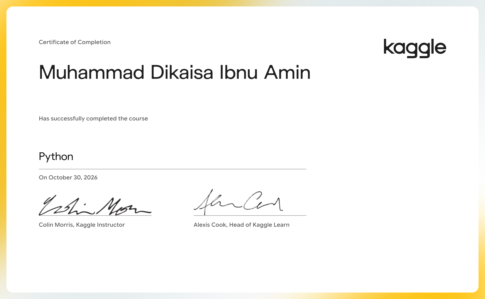

# 🏅 Certifications

Kumpulan sertifikat pembelajaran saya di bidang Data Analysis, Data Science, dan Machine Learning.

---

## Kaggle Learn

| Sertifikat | Tanggal | File |
|---|---|---|
| Python | 30 Okt 2026 | [Lihat](kaggle/kaggle-python.png) |
| Pandas | 3 Nov 2026 | [Lihat](kaggle/kaggle-pandas.png) |

---

## DQLab

| Sertifikat | Tanggal | Credential ID | File |
|---|---|---|---|
| Python Fundamental for Data Science | 28 Sep 2025 | DQLABINTP1IFOLDU | [Lihat](dqlab/dqlab-python-fundamental-ds.pdf) |
| Introduction to Data Science with Python | 16 Sep 2025 | DQLABINTP1QASHAR | [Lihat](dqlab/dqlab-intro-ds-python.pdf) |
| Guide to Learn Python with AI | 16 Sep 2025 | DQLABAI001MAHNEW | [Lihat](dqlab/dqlab-python-with-ai.pdf) |
| Fundamental SQL Using SELECT Statement | 15 Sep 2025 | DQLABSQLT1GTSMSH | [Lihat](dqlab/dqlab-sql-select.pdf) |
| Guide to Learn SQL with AI | 12 Sep 2025 | DQLABAI003OUKIAB | [Lihat](dqlab/dqlab-sql-with-ai.pdf) |

---

## On Progress

- Bootcamp Data Science & Machine Learning, Dibimbing.id

---

📂 Lihat project saya di [profil GitHub](https://github.com/Dikaisa).
